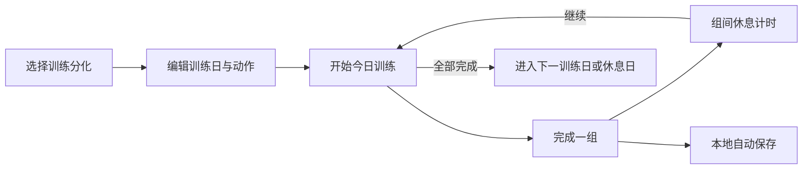
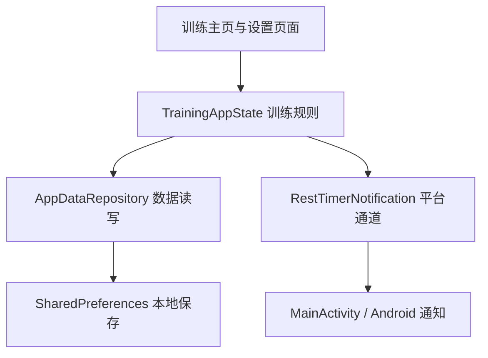

<div align="center">

# 训练记录 · Fitness Training App

一款专注于训练计划、组数进度与组间休息的 Flutter 健身记录应用。

[](https://flutter.dev/)
[](#运行项目)
[](#质量验证)
[](https://github.com/nannan9114/fitness-training-app/releases/latest)

[下载最新版 APK](https://github.com/nannan9114/fitness-training-app/releases/latest) · [查看源码](https://github.com/nannan9114/fitness-training-app)

</div>


> 上图是项目内设计原型生成的界面预览，实际安装包界面可能不同。训练时可集中查看当前动作、当前组和已休息时长。

## 概要

| 项目 | 内容 |
|---|---|
| 应用类型 | Flutter 健身训练与进度记录 App |
| Android 包名 | `com.megumin.fitness_training_app` |
| 最低 Android 版本 | Android 7.0（API 24，当前 Flutter 默认最低版本） |
| Android 架构 | `armeabi-v7a` / `arm64-v8a` / `x86_64` |
| 数据保存 | 训练计划与进度保存在本机；使用 SharedPreferences，无账号或自建后端依赖 |
| 当前公开安装包 | Debug APK，用于测试，不是应用商店正式签名包 |

> **APK 为什么比较大？** 当前公开包是未按处理器架构拆分的 Flutter Debug APK。它包含 Flutter 调试运行时及多种架构的原生库，且 Debug 构建没有 Release 构建的优化，因此单个文件会明显更大。这不是训练数据或 README 图片造成的。发布到 GitHub 可构建 Release APK 并按架构拆分（例如 `flutter build apk --release --split-per-abi`）；若要上 Google Play，通常使用 AAB。当前 Gradle 的 Release 签名仍使用 debug key，正式分发前还需配置自己的 release 签名。

## 它能做什么

- **管理训练计划**：编辑训练日、动作名称和目标组数。
- **长按拖动排序**：像整理桌面图标一样调整动作顺序。
- **三／四／五分化**：快速套用内置方案，也可以继续自定义。
- **安排休息日**：在训练周期任意位置插入休息日并设置持续天数。
- **记录完成进度**：完成一组后立即更新当前动作和整日进度。
- **组间休息计时**：开始下一组前显示计时，并通过 Android 通知提醒。
- **本地自动保存**：训练计划和进度保存在设备中，重新打开仍可继续。
- **按训练日重置**：只清空指定训练日，不影响其他训练记录。

## 使用流程



## 下载安装

前往 [Releases](https://github.com/nannan9114/fitness-training-app/releases/latest) 下载最新 Android APK。

当前公开包使用项目现有的 **debug 签名**，适合测试和覆盖安装此前由本项目生成、签名相同的 debug 版本；它不是应用商店正式签名包。

## 运行项目

发布验证使用 Flutter 3.47.1；项目要求 Dart `^3.13.1`，并需要可用的 Android SDK 开发环境。仓库包含 iOS 工程，但当前发布和验证范围为 Android。

```bash
git clone https://github.com/nannan9114/fitness-training-app.git
cd fitness-training-app
flutter pub get
flutter run
```

生成 Android debug APK：

```bash
flutter build apk --debug
```

输出位置：

```text
build/app/outputs/flutter-apk/app-debug.apk
```

## 项目结构

```text
fitness-training-app/
├─ lib/                              # Flutter 应用代码
│  ├─ main.dart                      # 启动入口
│  ├─ app.dart                       # 应用组件与主题接入
│  ├─ data/
│  │  ├─ default_plans.dart           # 三、四、五分化默认模板
│  │  └─ app_data_repository.dart     # 本地读写与数据恢复
│  ├─ models/app_data.dart           # 计划、动作与训练会话数据结构
│  ├─ screens/
│  │  ├─ training_screen.dart        # 今日训练、完成组数与休息计时
│  │  ├─ plan_editor_screen.dart     # 动作编辑、目标组数与拖动排序
│  │  ├─ settings_screen.dart        # 设置入口
│  │  ├─ split_settings_screen.dart  # 训练分化、顺序与休息日
│  │  └─ reset_training_day_screen.dart # 单个训练日重置
│  ├─ services/rest_timer_notification.dart # Flutter 与原生通知通信
│  ├─ state/training_app_state.dart  # 状态管理与训练规则
│  └─ theme/app_theme.dart           # 配色、字体和组件样式
├─ android/                          # Android 平台工程与构建配置
│  └─ app/src/main/
│     ├─ AndroidManifest.xml         # 应用声明与权限
│     ├─ kotlin/com/megumin/fitness_training_app/
│     │  └─ MainActivity.kt          # 原生通知与平台通道
│     └─ res/                        # 图标、启动界面和通知布局
├─ ios/                              # iOS 平台工程
├─ test/                             # 数据、状态和界面测试
│  └─ support/memory_storage.dart    # 测试用内存存储
├─ design-prototypes/index.html      # 可独立打开的 UI 设计原型
├─ docs/images/                      # README 展示图片
├─ pubspec.yaml                      # 应用版本、SDK 约束与依赖
├─ pubspec.lock                      # 锁定依赖版本
├─ analysis_options.yaml             # Dart 静态检查规则
└─ README.md                         # 项目介绍与开发指引
```

`build/` 和 `.dart_tool/` 为本地生成目录，由 Git 忽略；APK 放在 GitHub Releases 中下载。

## 技术与数据流

Flutter / Dart 负责界面和业务代码，Provider 连接页面与训练状态，SharedPreferences 保存设备本地数据；Android 计时通知通过 MethodChannel 调用 Kotlin 实现。



阅读代码可从 `main.dart` 开始，再看 `training_screen.dart` 和 `training_app_state.dart`。调整动作排序主要看 `plan_editor_screen.dart`；修改存储逻辑主要看 `app_data_repository.dart`。

## 质量验证

当前版本在发布前完成：

```text
flutter analyze  → No issues found
flutter test     → 14 tests passed
```

测试覆盖本地数据恢复、训练进度、计划编辑、动作排序、训练日重置、休息日切换及主要页面交互。

## 当前版本

| 项目 | 内容 |
|---|---|
| App 版本 | `1.0.0+1` |
| 发布标签 | `v1.0.0-build.1` |
| Android 包名 | `com.megumin.fitness_training_app` |
| 数据方式 | 设备本地保存，无账号和服务器依赖 |
