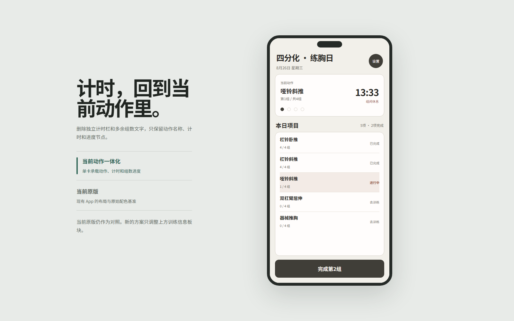
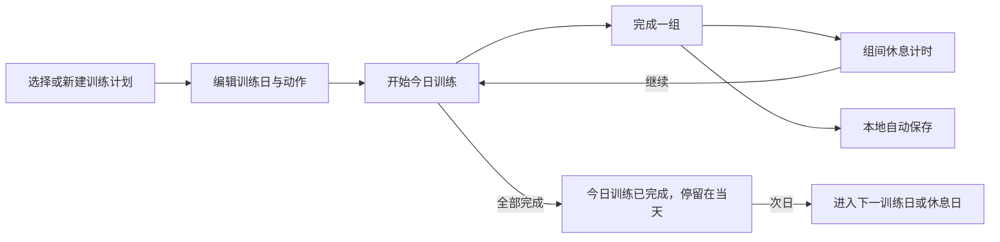
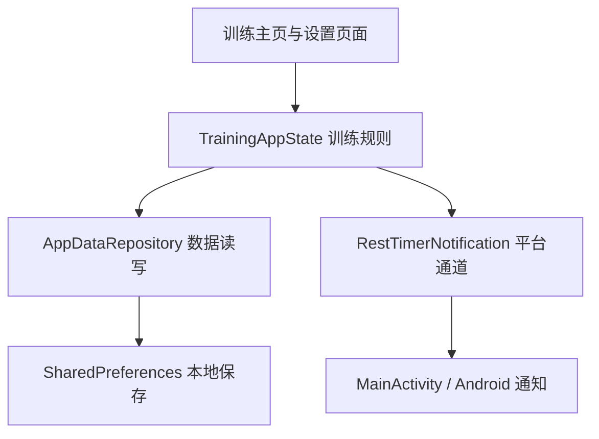

<div align="center">

# 训练记录 · Fitness Training App

一款支持多套训练计划、动作排序、组数记录与计划分享的 Flutter 健身 App。核心训练功能离线可用，无需注册账号。

[](https://flutter.dev/)
[](#运行项目)
[](#质量验证)
[](https://github.com/nannan9114/fitness-training-app/releases/latest)

[下载最新版 Debug APK](https://github.com/nannan9114/fitness-training-app/releases/latest/download/app-debug.apk) · [更新日志](CHANGELOG.md) · [查看源码](https://github.com/nannan9114/fitness-training-app)

</div>



> 上图是项目内设计原型生成的界面预览，实际安装包界面可能不同。训练时可集中查看当前动作、当前组和已休息时长。

## 概要

| 项目 | 内容 |
|---|---|
| 应用类型 | Flutter 健身训练与进度记录 App |
| Android 包名 | `com.megumin.fitness_training_app` |
| 最低 Android 版本 | Android 7.0（API 24，当前 Flutter 默认最低版本） |
| Android 架构 | `armeabi-v7a` / `arm64-v8a` / `x86_64` |
| 数据保存 | 训练计划与进度保存在本机；使用 SharedPreferences，无账号或自建后端依赖 |
| 当前公开安装包 | Debug APK，用于测试，不是应用商店正式签名包 |

> **APK 为什么比较大？** 当前公开包是未按处理器架构拆分的 Flutter Debug APK。它包含 Flutter 调试运行时及多种架构的原生库，且 Debug 构建没有 Release 构建的优化，因此单个文件会明显更大。这不是训练数据或 README 图片造成的。发布到 GitHub 可构建 Release APK 并按架构拆分（例如 `flutter build apk --release --split-per-abi`）；若要上 Google Play，通常使用 AAB。当前 Gradle 的 Release 签名仍使用 debug key，正式分发前还需配置自己的 release 签名。

## 它能做什么

- **训练计划**：选择、新建、复制和重命名分化，每套独立保存项目、顺序与进度。
- **计划分享**：菜单中选择“分享”复制代码；在“新建计划”中粘贴导入。分享不含个人进度，导入或创建副本均独立保存。
- **固定计划位置**：内置计划按三、四、五分化排列，新计划追加在后，切换和编辑不会改变位置。
- **训练项目**：编辑当前方案或指定方案的动作名称和目标组数。
- **训练顺序**：直接修改训练日名称，长按调整顺序，添加或删除训练日。
- **长按拖动排序**：调整动作顺序；长按后卡片放大、显示阴影与描边，并提供提示和轻震反馈。
- **三／四／五分化**：内置方案可继续编辑；切换其他分化后再切回，修改仍保留。
- **安排休息日**：在训练周期任意位置插入休息日并设置持续天数。
- **记录完成进度**：完成一组后立即更新当前动作和整日进度。
- **组间休息计时**：开始下一组前显示计时，并通过 Android 通知提醒。
- **本地自动保存**：训练计划和进度保存在设备中，重新打开仍可继续。
- **按训练日重置**：只清空指定训练日，不影响其他训练记录。

## 使用流程

从首页进入「训练设置」，按需要选择入口：

| 入口 | 用途 |
|---|---|
| **训练计划** | 选择正在使用的计划，新建、重命名、创建副本或分享计划 |
| **训练计划 → 编辑 → 训练顺序** | 修改训练日名称、长按排序、增删训练日、设置休息日天数 |
| **训练项目** | 编辑当前计划的动作名称、目标组数和动作顺序 |
| **训练计划 → 编辑 → 编辑训练项目** | 编辑指定计划的动作，不需要先切换到该计划 |
| **重置训练日** | 选择一个训练日，清空该日进度并从该日重新开始 |



## 计划管理

### 多套计划独立保存

内置三分化、四分化、五分化，也可以创建自己的计划，例如「上下肢」。每套计划保存自己的训练日、动作、目标组数、排序和训练进度。

- 点击 **切换使用** 启用计划，当前计划的按钮显示 **使用中**。
- 切换到另一套计划再切回来，原先编辑的项目和组数仍保留，不会被默认模板覆盖。
- 内置计划始终按三、四、五分化排列；新建、导入和创建的副本追加在后。切换、编辑和重启不会改变位置。
- 切换计划会结束当前组间计时；切回时恢复该计划的进度，跨日仍按训练日规则推进。

### 新建、创建副本与删除

| 操作 | 方法与结果 |
|---|---|
| 新建空白计划 | 点击「新建计划」，填写名称，分享代码留空；初始包含一个训练日和一个可编辑的新项目 |
| 创建副本 | 计划右上角菜单 →「创建副本」→ 确认名称；复制安排和项目，训练进度从零开始 |
| 重命名 | 计划右上角菜单 →「重命名」；修改名称不改变训练项目和进度 |
| 删除自建计划 | 先切换到其他计划，再在该计划菜单中选择「删除」并确认；内置计划不提供删除入口 |

新建、导入和创建副本后会进入编辑页，**不会自动切换当前训练计划**。编辑完成后，可回到计划列表点击「切换使用」。

### 训练日与动作编辑

1. 在计划卡片上点击「编辑」，进入 **训练顺序**。
2. 点击训练日旁的铅笔改名；长按卡片上下拖动，调整训练日与休息日的位置。
3. 根据需要添加训练日或休息日，休息天数可用加减按钮调整。
4. 点击「编辑训练项目」，为对应训练日修改动作名称、目标组数或添加项目。若顺序尚未保存，按钮会显示「保存并编辑训练项目」。
5. 长按动作卡片调整顺序：卡片会轻微放大，显示阴影和描边，并提示拖动状态。
6. 点击 **保存修改**。若有未保存的修改就返回，会提示保存、放弃或继续编辑。

每个计划至少保留一个训练日，每个训练日至少保留一个项目。当前正在训练的训练日和动作不能直接删除，可先在「重置训练日」中选择其他训练日后再调整。

## 分享与导入计划

无需账号或云端同步，即可通过文本代码把训练安排发给另一位使用者，也可以保存代码供自己以后导入。


**发送方：** 进入「训练计划」，点击目标计划右上角菜单 →「分享」→「复制分享代码」，将完整代码发给对方。

**接收方：** 点击「新建计划」，将代码粘贴到 **粘贴分享代码（可选）** 输入框，再点击「创建」。名称留空时沿用分享计划的名称，也可以填写新名称。导入后可继续编辑，确认后点击「切换使用」。

| 会分享的内容 | 不包含的内容 |
|---|---|
| 计划名称、训练日名称和顺序 | 已完成的组数、当前训练进度 |
| 动作名称、目标组数和动作顺序 | 组间休息计时状态 |
| 休息日位置及持续天数 | 原计划在设备内的标识 |

代码以 `FTA1:` 开头，请完整复制，包括前缀。双方需要使用支持分享代码的版本（1.1.1 及以上，建议安装最新版）。无效或不支持的代码会显示错误提示，不会覆盖现有计划。副本和导入的计划独立保存，后续修改不会同步到对方。

## 进度、保存与升级

- **组数实时保存**：完成一组后立即记录；计划、训练顺序和项目编辑则需要点击「保存修改」。
- **当天完成不提前跳日**：完成全部项目后显示「今日训练已完成」，当天重开仍停留在该训练日，次日进入下一训练日或休息日。
- **未完成的训练可继续**：不会仅因日期变化就跳过未完成的训练；延后完成时，以实际完成日期作为后续切日基准。
- **指定训练日重置**：清空所选训练日的进度并从该日开始，保留其他训练日的已存进度。
- **本机保存**：没有账号登录、云端备份或跨设备自动同步。分享代码只保存计划安排，不是完整的训练进度备份。
- **覆盖安装升级**：同包名、同签名的新版本可以覆盖旧版。旧版单计划数据升级为多计划存储前会先在本机备份；备份或迁移写入失败时不会用默认计划覆盖原数据。

为保留本机记录，请直接覆盖安装，不要先卸载或清除应用数据。旧版本已覆盖丢失的项目无法通过升级找回；迁移后也不建议降级到不支持多计划数据结构的旧版。

## 下载安装

当前版本为 **1.1.2（build 5）**：[直接下载 Debug APK](https://github.com/nannan9114/fitness-training-app/releases/latest/download/app-debug.apk)（约 146.4 MiB），或前往 [Releases](https://github.com/nannan9114/fitness-training-app/releases/latest) 查看版本说明和校验文件。

新版支持独立保存多套计划、固定计划顺序、创建副本和分享代码导入。请覆盖安装以保留本机记录。分享代码需要收发双方使用支持此功能的版本。历史版本只保留发布记录，安装包仅保留最新版。

新版同时保留当天训练完成后不提前跳日的修复和动作长按排序反馈，删除重复的“使用中”标签。详细说明见 [更新日志](CHANGELOG.md)。

当前公开包使用项目现有的 **debug 签名**，适合测试和覆盖安装此前由本项目生成、签名相同的 debug 版本；它不是应用商店正式签名包。

## 运行项目

发布验证使用 Flutter 3.47.1；项目要求 Dart `^3.13.1`，并需要可用的 Android SDK 开发环境。仓库包含 iOS 工程，但当前发布和验证范围为 Android。

```bash
git clone https://github.com/nannan9114/fitness-training-app.git
cd fitness-training-app
flutter pub get
flutter run
```

生成 Android debug APK：

```bash
flutter build apk --debug
```

输出位置：

```text
build/app/outputs/flutter-apk/app-debug.apk
```

## 项目结构

```text
fitness-training-app/
├─ lib/                              # Flutter 应用代码
│  ├─ main.dart                      # 启动入口
│  ├─ app.dart                       # 应用组件与主题接入
│  ├─ data/
│  │  ├─ default_plans.dart           # 三、四、五分化默认模板
│  │  ├─ plan_share_code.dart         # 分享代码编码、解析与内容校验
│  │  └─ app_data_repository.dart     # 本地读写与数据恢复
│  ├─ models/app_data.dart           # 计划、动作与训练会话数据结构
│  ├─ screens/
│  │  ├─ training_screen.dart        # 今日训练、完成组数与休息计时
│  │  ├─ plan_editor_screen.dart     # 动作编辑、目标组数与拖动排序
│  │  ├─ settings_screen.dart        # 设置入口
│  │  ├─ split_settings_screen.dart  # 分化选择、新建、复制和管理
│  │  ├─ training_schedule_screen.dart # 训练日改名、顺序与休息日
│  │  ├─ editor_helpers.dart         # 名称输入与未保存修改提示
│  │  └─ reset_training_day_screen.dart # 单个训练日重置
│  ├─ services/rest_timer_notification.dart # Flutter 与原生通知通信
│  ├─ state/training_app_state.dart  # 状态管理与训练规则
│  └─ theme/app_theme.dart           # 配色、字体和组件样式
├─ android/                          # Android 平台工程与构建配置
│  └─ app/src/main/
│     ├─ AndroidManifest.xml         # 应用声明与权限
│     ├─ kotlin/com/megumin/fitness_training_app/
│     │  └─ MainActivity.kt          # 原生通知与平台通道
│     └─ res/                        # 图标、启动界面和通知布局
├─ ios/                              # iOS 平台工程
├─ test/                             # 数据、状态和界面测试
│  └─ support/memory_storage.dart    # 测试用内存存储
├─ design-prototypes/index.html      # 可独立打开的 UI 设计原型
├─ docs/images/                      # README 展示图片
├─ pubspec.yaml                      # 应用版本、SDK 约束与依赖
├─ pubspec.lock                      # 锁定依赖版本
├─ analysis_options.yaml             # Dart 静态检查规则
└─ README.md                         # 项目介绍与开发指引
```

`build/` 和 `.dart_tool/` 为本地生成目录，由 Git 忽略；APK 放在 GitHub Releases 中下载。

## 技术与数据流

Flutter / Dart 负责界面和业务代码，Provider 连接页面与训练状态，SharedPreferences 保存设备本地数据；Android 计时通知通过 MethodChannel 调用 Kotlin 实现。



阅读代码可从 `main.dart` 开始，再看 `training_screen.dart` 和 `training_app_state.dart`。调整动作排序主要看 `plan_editor_screen.dart`；修改存储逻辑主要看 `app_data_repository.dart`。

## 质量验证

1.1.2 版本已完成：

```text
flutter analyze  → No issues found
flutter test     → 27 tests passed
```

测试覆盖本地数据恢复、训练进度、计划编辑、动作排序及保存、训练日重置、休息日切换及主要页面交互；包含延后 1 天或 7 天完成训练、连续多轮训练、当天刷新和重新启动的回归检查。

| 验证范围 | 已覆盖场景 |
|---|---|
| 多计划与排序 | 切换、编辑、创建副本和重启后顺序固定；各计划数据及进度独立恢复 |
| 计划分享 | 分享代码内容往返一致、无效及不支持的代码拒绝导入、剪贴板复制与粘贴创建流程 |
| 数据保护 | 旧版迁移前备份、备份或保存失败保留原数据、未知数据版本不重置 |
| 编辑交互 | 新建计划、训练日改名、添加休息日、编辑项目、长按排序与未保存提示 |
| 训练日推进 | 延后完成当天不切日、次日推进、休息日时长与连续多轮训练 |

以上为自动测试覆盖范围。Android APK 已核对包名、版本和签名；实际震动、通知显示等效果仍取决于设备及系统设置。

## 当前版本

| 项目 | 内容 |
|---|---|
| App 版本 | `1.1.2+5` |
| GitHub 发布标签 | `v1.1.2-build.5` |
| Android 包名 | `com.megumin.fitness_training_app` |
| 数据方式 | 设备本地保存，无账号和服务器依赖 |
